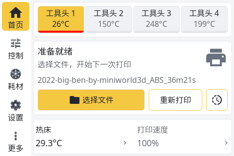
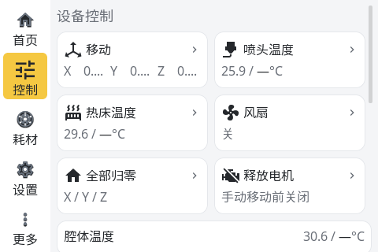
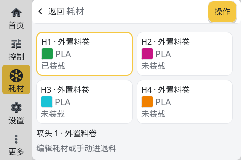
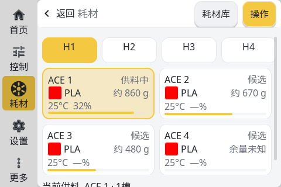
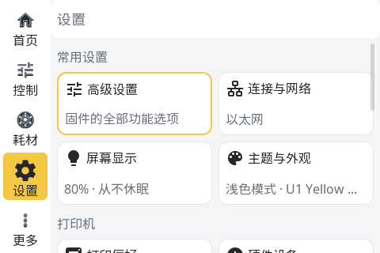
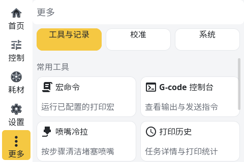

# UI.4：U1 全界面改版

目标版本：`2.1.0-233-dev.3-ui.4`。分支：`codex/u1-native-ui-20261110`。

本次针对“只改了部分设置”的反馈，重新组织实际运行的 LVGL/C++ 原生触屏界面。固定 480×320 横屏、白底黄主色、深灰文字，以“首页 / 控制 / 耗材 / 设置 / 更多”五个入口管理完整界面。所有截图由原生程序绘制；模拟后端中的文件、数值和动作结果仅用于离线检查。

## 页面与行为

| 范围 | UI.4 的变化 | 数据与操作边界 |
| --- | --- | --- |
| 启动画面、首次设置与引导 | 两个启动进程共享 U1 白黄启动卡；向导、连接、语言及六步引导统一布局 | 保留原启动交接、配置保存与完成状态 |
| 首页 | 四个头同时显示独立温度与已供料颜色；任务卡展示文件、进度、剩余时间和层数；暂停/恢复、详情、停止直接可达 | 颜色读取头的实际上游料槽；候选供料器不改变已供料显示；打印操作沿用共享控制器及设备确认 |
| 控制 | 移动、温度、风扇、挤出、速度等入口重排为触控卡片，坐标和步距清晰分开 | 复用既有能力判断和操作回调；移动/热动作仍受原有条件限制 |
| 无 ACE 耗材 | 四个外置料盘；每头独立材质与颜色编辑、激活和手动进退料 | 不显示估算余量；仅激活且满足温度、料路、挤出机和空闲条件后允许进退料 |
| ACE 耗材 | 四头库存、供料器选择、槽位详情、RFID、材料目录、自动续料和烘干整套重排 | 已供料与当前候选分开；稳定设备身份和现场映射继续由原后端维护 |
| 文件与打印准备 | 480 屏默认文件列表；文件名、预览、条件检查、准备选项和打印按钮分层 | 内容区可滚动；打印和删除操作固定在页底，继续执行原文件/能力/预检流程 |
| 打印任务 | 进度和控制按钮排在上方，预览、层数和关键读数在下方；调优另有完整页面 | 暂停等待、暂停完成、恢复等待、错误和停止确认继续读取共享状态 |
| 历史、队列、消息 | 统计卡、任务列表与详情、滚动队列和事件记录使用同一视觉结构 | 消息与历史始终有入口；队列按设备能力显示 |
| 设置与更多 | 双列入口、清晰分组，网络、显示、设备、系统工具及条件页面统一重排 | 高级设置仍为八个分组，保留当前值→新值确认和真实服务回读 |
| 校准与维护 | 调平、网格、输入整形、压力提前、冷拉、偏移、皮带及探针工具均纳入范围 | 校准流程及能力限制沿用原生实现 |
| 弹窗与异常 | 普通确认、危险操作、断料、恢复、热床检查、打印异常和掉电恢复统一 | 小屏按钮至少 44px；三/四按钮自动分两行；长内容滚动，操作区固定 |

覆盖清单同时记录生产导航、能力条件页面和开发入口。它是源码可达性与布局审阅清单，不表示已在真实打印机上逐页验收。完整清单和实际截图索引随验证包提供。

## 原生屏幕预览

以下为 480×320 原生程序的离线模拟画面，数值和任务来自模拟后端。

| 首页 | 控制 |
| --- | --- |
|  |  |
| 无 ACE：四个外置料盘 | 有 ACE：真实供料与候选分开 |
|  |  |
| 设置 | 更多 |
|  |  |

## 设备状态如何进入新界面

首页温度直接绑定各头持续更新的温度 subject。头的颜色先定位物理头槽，再查询后端报告的 `upstream_slot`；只有真实已连接的来源槽才能提供已供料颜色。U1 固定四头由 Klipper 发现时，工具本身可能没有 AMS 拓扑字段，因此使用已验证的四头库存映射补齐这条读取路径。候选 ACE 选择不参与这一计算。

首页暂停、恢复和停止与打印任务页使用同一个 `PrintControlButtons` 控制器。一次操作开始后按钮进入等待状态，直到后端报告对应状态才更新文案并恢复可用。耗材的“激活此喷头”同样只发起原有换头请求，等待活动工具回读；看到按钮不等于跳过温度或运动检查。

## 已有用户的首页迁移

`u1-native-ui-setup.py` 只将与旧版发行默认值完全一致的首页迁移到 UI.4。迁移前保存 `settings.json.pre-233-ui4-dashboard`，保留设备连接、触摸校准、主题和其他用户设置。已经自定义过的布局保持原样；再次启动不会重复备份或覆盖。首次安装直接使用四头温度、任务卡、热床和速度的新默认布局。

启动配置脚本纳入运行包的构建输入清单，字体、六个源码补丁、设备服务和构建规则共同绑定到分发包指纹。原有五个补丁保持不变；UI.4 作为第六个增量补丁应用在固定上游提交上。

## 离线检查方法

原生绘制运行于真实 480×320 LVGL/SDL 程序，使用项目既有模拟设备。此环境不允许 Unix socket，检查程序使用单独编译的本地 JSONL 诊断传输，仍走原 RemoteControlServer 的主线程调度和界面回调；诊断传输不进入生产源码补丁、ARM 程序或完整固件。

打印检查使用模拟设备真实的自动打印、暂停和恢复通知，观察进度与剩余时间、按钮禁用/恢复及任务页同步。上游旧 `scenario` 示例会直接写部分 subject，不能完整更新当前打印生命周期；这类注入图片不作为打印行为回归的证据。

源码回归、相关 Catch2 测试、字体重建、XML 检查、运行包和完整固件的最终数量与校验和统一写入产物索引。设备侧升级互斥、代理绕过和新→旧→新槽位配置加载继续复测。

## 验证范围

本轮没有连接、重启或刷写打印机。实际屏幕触摸、真实启动时序、运动、加热、挤出、风扇与 ACE 硬件行为仍需独立验收。模拟后端缺少独立挤出机温度映射时，手动进退料保持锁定；不为截图或测试放宽生产检查。
